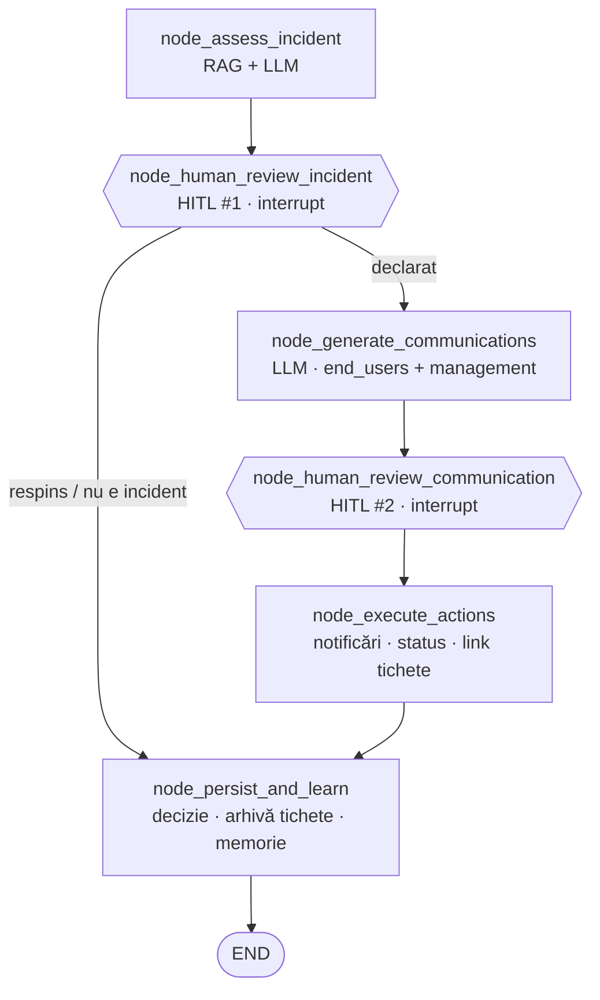
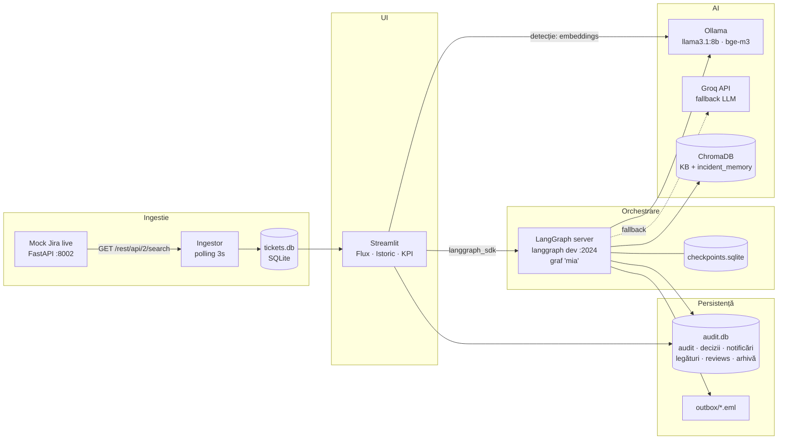
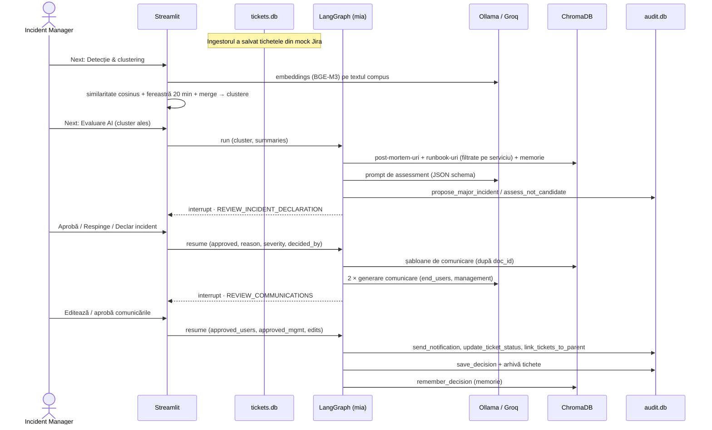
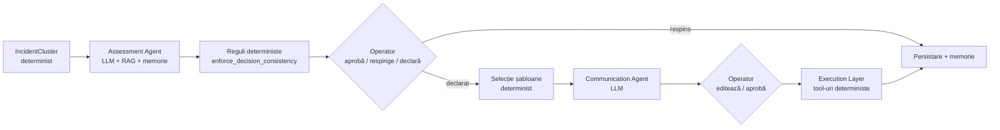
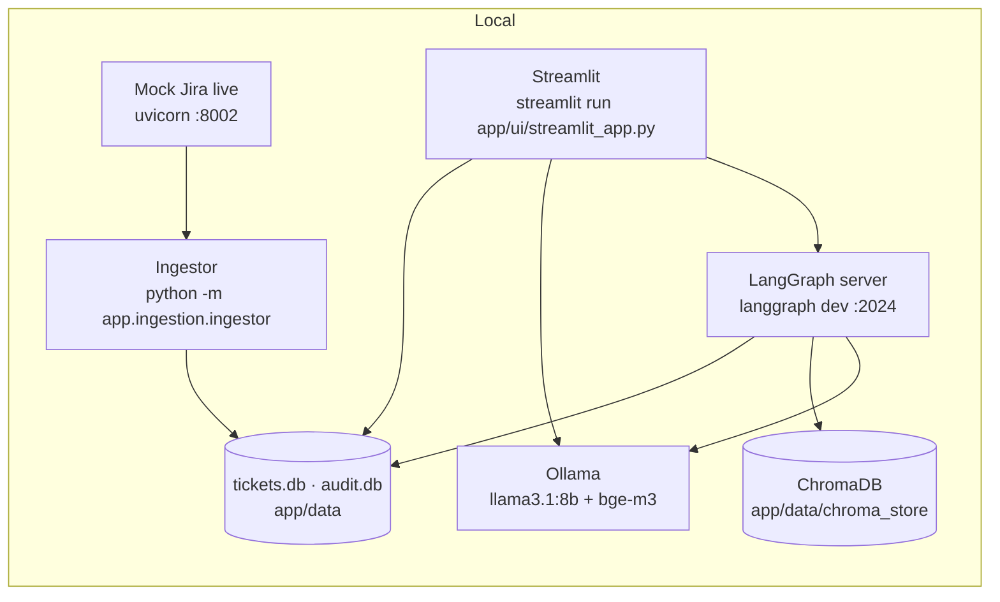

# Documentație Proiect
## Agent AI pentru Detecția Incidentelor Majore și Generarea Comunicării Automate
### Categorie: IT Service Management (ITSM) – Incident Management

**Denumire agent:** Major Incident Agent (MIA)
**Autor:** _[]_

> **Stare document:** sincronizat cu codul sursă (aplicația `app/`, scripturile `scripts/`, testele `tests/`, UI-ul Streamlit și pagina KPI). Unde documentația inițială propunea ceva care nu există în cod (API FastAPI propriu, Docker, Arize Phoenix, RAGAS, DBSCAN/HDBSCAN), secțiunea a fost corectată, iar elementul a fost mutat la [Dezvoltări viitoare](#103-dezvoltări-viitoare).

---

## Cuprins

1. [Definirea problemei și scopul proiectului](#1-definirea-problemei-și-scopul-proiectului)
2. [Înțelegerea procesului (AS-IS)](#2-înțelegerea-procesului-as-is)
3. [Soluția propusă / Fluxul TO-BE](#3-soluția-propusă--fluxul-to-be)
4. [Arhitectura generală a sistemului](#4-arhitectura-generală-a-sistemului)
5. [Structura datelor și abordarea RAG](#5-structura-datelor-și-abordarea-rag)
6. [Reasoning / Decizie / Execuție](#6-reasoning--decizie--execuție)
7. [KPI-uri și Success Criteria](#7-kpi-uri-și-success-criteria)
8. [Observabilitate și audit](#8-observabilitate-și-audit)
9. [Stack tehnic și livrarea ca produs](#9-stack-tehnic-și-livrarea-ca-produs)
10. [Riscuri, limitări și dezvoltări viitoare](#10-riscuri-limitări-și-dezvoltări-viitoare)
11. [Anexe](#11-anexe)

---

## 1. Definirea problemei și scopul proiectului
### 1.1 Context business / IT

În organizațiile mari, un incident major — precum indisponibilitatea unei aplicații critice, o defecțiune a rețelei sau o cădere a serviciilor cloud — generează frecvent un val de tichete individuale, raportate într-un interval scurt de timp de utilizatori diferiți, dar având aceeași cauză reală.

Într-un proces ITSM tradițional, fiecare incident este înregistrat și analizat separat de către echipa de suport. Atunci când mai mulți utilizatori raportează aceeași problemă, tichetele similare pot fi tratate inițial ca incidente distincte. Identificarea faptului că acestea au o cauză comună și reprezintă, de fapt, **un singur incident major**, se bazează în mare parte pe analiza manuală și pe experiența operatorilor sau a Incident Managerului.

Corelarea incidentelor presupune compararea unor informații precum titlul și descrierea, serviciul sau aplicația afectată, utilizatorii, locația și momentul raportării. Atunci când numărul de tichete este mare, analiza manuală devine dificilă și poate întârzia identificarea unui incident major.

După identificarea unui posibil incident major, comunicarea către utilizatorii afectați și management este adesea realizată manual. Acest lucru poate duce la întârzieri și la mesaje diferite ca exprimare, structură și detaliile date, în funcție de destinatari.

Această abordare poate conduce la:
- **identificarea întârziată a incidentelor majore, din cauza lipsei corelării automate între tichetele similare**;
- **creșterea efortului manual, necesar pentru analizarea unui număr mare de tichete**;
- **prioritizare și escaladare inconsistente, în funcție de experiența și disponibilitatea operatorilor**;
- **creșterea numărului de tichete duplicate, deoarece utilizatorii pot raporta aceeași problemă fără să știe că aceasta este deja investigată**;
- **întârzierea comunicării către utilizatori și management, precum și transmiterea unor mesaje diferite ca structură și conținut**;
- **creșterea MTTR (Mean Time to Repair), ca urmare a timpului suplimentar necesar pentru identificarea și gestionarea incidentului**;
- **scăderea încrederii utilizatorilor și a business-ului în serviciile IT, ca urmare a lipsei de vizibilitate și a comunicării întârziate**.

Prin urmare, problema nu este doar volumul mare de tichete, ci și dificultatea de a identifica rapid faptul că mai multe incidente aparent independente au aceeași cauză și fac parte dintr-un singur incident major.

### 1.2 Obiectivul proiectului

Obiectivul proiectului este dezvoltarea unui agent AI (**Major Incident Agent**) care:
1. **Detectează automat** posibile incidente majore prin analiza similarității semantice (embeddings BGE-M3 + similaritate cosinus + clustering pe fereastră de timp glisantă) între tichetele ingerate dintr-un sistem ITSM (mock Jira-like).
2. **Evaluează** (prin LLM, cu output structurat validat Pydantic) dacă un cluster de tichete similare reprezintă cu adevărat un candidat de incident major, pe baza informațiilor istorice relevante (RAG: post-mortem-uri și runbook-uri) și a deciziilor umane anterioare (memorie de incidente).
3. **Generează automat** un draft de comunicare (separat pentru utilizatorii finali și pentru management), pe baza unor șabloane selectate determinist din knowledge base și a datelor incidentului.
4. Trece **fiecare cluster evaluat** și **fiecare comunicare** printr-un **punct de aprobare umană** (human-in-the-loop, implementat cu `interrupt()` din LangGraph) înainte de orice acțiune vizibilă extern.
5. **Execută determinist** acțiunile aprobate (trimitere notificare simulată, actualizare status tichete, legarea tichetelor de incidentul părinte) și **învață** din decizia umană (memorie de incidente).
6. **Loghează și expune** întregul lanț de decizie (audit trail în SQLite, stare LangGraph vizibilă în LangGraph Studio, istoric în UI) și **măsoară impactul** printr-un dashboard de KPI.

### 1.3 Scopul proiectului (In-Scope)

- Ingestia de tichete (date mock în format Jira-like) printr-un mock Jira API „live”, care emite tichete în timp real, și un ingestor care le preia periodic și le salvează în SQLite.
- Calcul de embeddings (BGE-M3 prin Ollama) pe textul compus al tichetului (Summary + Description + Component + Labels) și clustering pe similaritate cosinus, pe o fereastră de timp glisantă configurabilă (implicit 20 min), cu unificarea clusterelor suprapuse.
- Un modul LLM de **assessment** (decide dacă un cluster este candidat de incident major, estimează severitatea SEV1/SEV2/SEV3, motivează) – output JSON validat Pydantic, cu reguli deterministe de consistență aplicate după răspunsul LLM-ului.
- Un modul RAG (ChromaDB, embeddings BGE-M3, distanță cosinus) cu bază de cunoștințe: incidente majore istorice (post-mortem-uri), runbook-uri și șabloane de comunicare, plus o colecție separată de **memorie de incidente** (decizii umane anterioare).
- Generare comunicare (2 variante: user-facing, management-facing), output JSON validat, cu șablon selectat determinist după audiență, severitate și serviciu.
- Aprobare umană în două puncte: (1) declararea incidentului, (2) comunicările (cu posibilitate de editare; originalul se păstrează pentru audit).
- Execuție deterministă a acțiunilor aprobate (notificare simulată – fișier `.eml` + înregistrare în SQLite; actualizare status tichete; link-uire tichete la incidentul părinte).
- Gestionarea tichetelor din afara incidentelor (marcare „Tratat individual” / „De urmărit”, retenție configurabilă, reclusterizare, atașare manuală a unui tichet la un incident declarat).
- Audit trail (SQLite) și orchestrare cu stare persistentă (LangGraph + checkpointer SQLite, inspectabilă în LangGraph Studio).
- KPI de măsurare a impactului față de procesul manual (pagină dedicată în UI) și scripturi de evaluare offline (detecție, assessment, retrieval).
- Livrare: UI Streamlit (flux incident, istoric, KPI) care apelează serverul LangGraph prin `langgraph_sdk`; rulare locală.

### 1.4 În afara scopului (Out of Scope)

- Remedierea tehnică efectivă a incidentului (root cause fixing) – agentul **nu** execută acțiuni de remediere infrastructură (restart servicii, rollback deploy etc.), doar detectează, evaluează și comunică.
- Integrare live cu un ITSM real de producție (ServiceNow/Jira) – se lucrează cu date mock.
- Ciclul de viață de după declarare: comunicări de update, comunicare de închidere/rezolvare, urmărirea evoluției incidentului (statusurile `Resolved`/`Closed` există în model, dar nu sunt folosite de flux).
- Traducere în mai multe limbi a comunicărilor (comunicările se generează în engleză; interfața operatorului este în română).
- Predicție proactivă de incidente înainte ca tichetele să apară (capacity/anomaly forecasting) – agentul este reactiv, bazat pe tichetele deja create.
- Fine-tuning propriu al unui model LLM (se folosește prompt engineering pe model open-source via Ollama, cu Groq ca fallback).
- Containerizare (Docker/docker-compose), API REST propriu pentru MIA și instrumentare Arize Phoenix / RAGAS – nu sunt implementate în versiunea curentă (vezi [10.3](#103-dezvoltări-viitoare)).

### 1.5 Asumpții (Assumptions)

- Tichetele (format Jira-like) conțin minim: `key`, `fields.created`, `fields.summary`, `fields.description`, `fields.components[0].name` (serviciul/aplicația afectată), `fields.priority`, `fields.reporter`, `fields.labels`, `fields.location`.
- Volumul și distribuția temporală a tichetelor mock reflectă tipare realiste (perioade „calme” + „burst”-uri simulând incidente majore + „capcane” de fals pozitiv).
- Un incident „major” este definit organizațional prin criteriile din runbook-uri (praguri de severitate per serviciu), nu doar prin percepția LLM-ului; decizia finală aparține întotdeauna operatorului.
- Accesul la Ollama (local: `llama3.1:8b` pentru reasoning, `bge-m3` pentru embeddings) este disponibil în mediul de dezvoltare/demo; Groq (cheie API) este opțional, ca provider fallback pentru LLM.

## 2. Înțelegerea procesului (AS-IS)
### 2.1 Procesul tradițional de Incident Management

Într-un proces ITSM tradițional, incidentele sunt raportate și gestionate inițial ca tichete individuale. Un utilizator poate raporta o problemă prin intermediul unui portal self-service, email, telefon sau al altui canal disponibil, iar sistemul ITSM creează un tichet asociat problemei raportate.

Procesul tradițional poate fi reprezentat astfel:

```text
Incident raportat
       ↓
Creare tichet
       ↓
Clasificare și prioritizare
       ↓
Alocare către echipa responsabilă
       ↓
Analiză și investigare manuală
       ↓
Căutare manuală a incidentelor similare
       ↓
Identificare posibil Major Incident
       ↓
Escaladare / Confirmare
       ↓
Declarare Major Incident
       ↓
Comunicare către utilizatori și management
       ↓
Rezolvare Ticket
       ↓
Închidere Ticket
```

Procesul este în principal bazat pe analiza individuală a tichetelor și pe intervenția persoanelor responsabile de Incident Management. Corelarea mai multor incidente care pot avea aceeași cauză este realizată în funcție de informațiile disponibile și de observațiile echipelor implicate.

### 2.2 Raportarea și înregistrarea incidentelor

Fiecare problemă raportată de un utilizator este înregistrată, de regulă, ca un tichet individual în sistemul ITSM.

În cazul în care mai mulți utilizatori întâmpină aceeași problemă, pot fi create mai multe tichete distincte. De exemplu, pentru o problemă asociată serviciului VPN pot apărea următoarele incidente:
- INC001 — „Cannot access corporate VPN”
- INC002 — „VPN connection failing”
- INC003 — „Remote employees cannot connect to VPN”
- INC004 — „VPN authentication unavailable”
- INC005 — „Unable to establish VPN connection”

Deși aceste tichete pot descrie aceeași problemă din perspective diferite, ele sunt inițial înregistrate și procesate separat.

### 2.3 Clasificarea, prioritizarea și alocarea

După înregistrare, fiecare tichet este analizat și clasificat conform procesului ITSM existent.
În această etapă sunt stabilite, în funcție de informațiile disponibile:
- categoria incidentului;
- serviciul afectat;
- impactul;
- urgența și prioritatea;
- echipa responsabilă de investigare și rezolvare.

Tichetele sunt apoi alocate către grupurile de suport sau echipele tehnice corespunzătoare.
Analiza este realizată în principal la nivelul fiecărui tichet. În consecință, faptul că mai multe incidente pot avea aceeași cauză nu este întotdeauna evident în această etapă.

### 2.4 Investigarea și identificarea incidentelor similare

Echipa responsabilă investighează fiecare incident și încearcă să determine cauza problemei.
Atunci când există suspiciunea că mai multe incidente sunt corelate, operatorii pot căuta manual alte tichete cu simptome similare. Această analiză poate lua în considerare informații precum:
- descrierea incidentului;
- serviciul afectat;
- momentul apariției;
- simptomele raportate;
- numărul de utilizatori afectați;
- informațiile disponibile în sistemul ITSM.

Identificarea unei relații între incidente depinde de informațiile disponibile și de experiența persoanelor care efectuează analiza.
În cazul unor formulări diferite ale aceleiași probleme, corelarea poate necesita o analiză suplimentară.

### 2.5 Identificarea și confirmarea unui posibil Incident Major

Un posibil Incident Major poate fi identificat atunci când operatorii observă un volum neobișnuit de incidente similare, un impact semnificativ asupra unui serviciu sau alte indicii care sugerează existența unei probleme comune.

Identificarea poate apărea, de exemplu:
- în urma analizei dashboard-urilor ITSM;
- după mai multe escaladări;
- prin comunicarea dintre echipe;
- ca urmare a creșterii numărului de incidente pentru același serviciu;
- în urma identificării unor simptome comune în mai multe tichete.

După identificarea unui posibil Major Incident, situația este analizată împreună cu echipele tehnice relevante pentru confirmarea impactului și a existenței unei posibile cauze comune.
În funcție de criteriile organizației, Incident Manager-ul sau persoana responsabilă decide dacă incidentul trebuie declarat Major Incident.

### 2.6 Comunicarea

Pe durata unui Major Incident, informațiile despre incident sunt comunicate către părțile interesate relevante.
Comunicarea poate include:
- serviciul afectat;
- problema identificată sau suspectată;
- impactul asupra utilizatorilor;
- statusul curent;
- acțiunile aflate în desfășurare;
- următorul update estimat, atunci când acesta este disponibil.

Mesajele pot fi adaptate în funcție de audiență. Utilizatorii finali necesită, de regulă, informații orientate către impact și disponibilitatea serviciului, în timp ce managementul necesită informații suplimentare privind amploarea incidentului, impactul și acțiunile de remediere.
În procesul actual, pregătirea și transmiterea comunicărilor presupun intervenție manuală.

### 2.7 Rezolvarea și închiderea

După identificarea și implementarea soluției, serviciul este readus în starea normală de funcționare.
Incidentele asociate sunt actualizate conform procedurilor ITSM, iar după îndeplinirea criteriilor de închidere acestea sunt închise.
Informațiile rezultate în urma incidentului pot fi ulterior utilizate pentru documentație, analiză post-incident și îmbunătățirea procesului.

### 2.8 Principalele blocaje și limitări ale procesului

Analiza procesului actual evidențiază mai multe puncte în care activitățile manuale pot produce întârzieri sau inconsistențe.

| # | Blocaj / limitare | Impact asupra procesului |
|---|---|---|
| 1 | Identificarea unui volum neobișnuit de incidente depinde de observația operatorilor | Un posibil Major Incident poate fi identificat cu întârziere |
| 2 | Tichetele sunt analizate inițial individual | Incidentele care au aceeași cauză pot rămâne fragmentate |
| 3 | Incidentele similare pot utiliza formulări diferite | Corelarea lor necesită analiză manuală |
| 4 | Confirmarea unui posibil Major Incident necesită coordonare între echipe | Poate crește timpul până la escaladare și declarare |
| 5 | Asocierea incidentelor cu un incident-părinte poate fi manuală | Crește efortul operațional și riscul de inconsistențe |
| 6 | Comunicările sunt pregătite și adaptate manual | Pot apărea întârzieri sau diferențe între comunicări |
| 7 | Informațiile istorice sunt accesate manual | Contextul relevant poate să nu fie identificat la momentul potrivit |
| 8 | Deciziile și acțiunile pot fi distribuite între mai multe sisteme și persoane | Trasabilitatea procesului poate fi dificil de reconstruit |

### 2.9 Ce poate fi îmbunătățit cu ajutorul AI

Din analiza AS-IS reies câteva puncte concrete unde un agent AI poate elimina munca manuală, fără să înlocuiască decizia umană pe zonele riscante:

| Etapă manuală (AS-IS) | Ce automatizează AI | Ce rămâne manual |
|---|---|---|
| Căutare manuală a tichetelor similare | Embeddings + clustering pe similaritate cosinus, pe fereastră de timp glisantă, rulat la cererea operatorului pe tichetele ingerate | Declanșarea rulării de detecție |
| Interpretarea dacă un cluster e „suficient de mare/grav” | LLM Assessment Agent, fundamentat pe RAG (incidente istorice, runbook-uri) și pe deciziile umane anterioare | Confirmarea finală a candidatului |
| Scriere comunicare (user vs management) | LLM Communication Agent, pe bază de șabloane din knowledge base | Aprobarea și eventuala editare a textului |
| Declarare oficială Major Incident | Propunere structurată, cu motivare și severitate estimată | Decizia de declarare (aprobare/respingere sau declarare proprie, dacă AI nu a propus) |
| Legarea tichetelor la incidentul părinte | Tool determinist, executat automat după aprobare | Atașarea manuală a tichetelor sosite târziu |

## 3. Soluția propusă / Fluxul TO-BE

### 3.1 Descrierea soluției

Soluția propusă urmărește automatizarea etapelor de identificare și evaluare a incidentelor care pot indica existența unui Incident Major, păstrând controlul uman asupra deciziilor cu impact operațional.

În locul identificării exclusiv manuale a relațiilor dintre tichete, sistemul ingerează continuu tichetele noi, iar la cererea operatorului analizează tichetele disponibile și identifică grupuri de incidente care prezintă caracteristici comune.

Fluxul TO-BE este:
```text
Tichet nou (mock Jira live)
    ↓
Ingestie (polling) în baza locală de tichete
    ↓
Detecție: embeddings + similaritate cosinus + fereastră glisantă (20 min)
    ↓
Identificarea clusterelor de incidente similare (min. 3 tichete)
    ↓
Evaluare AI (LLM + RAG + memorie): candidat Incident Major? severitate?
    ↓
Decizie Incident Manager (pentru fiecare cluster evaluat)
    ├── respins / „nu e incident” → salvare decizie + memorie; tichetele rămân individuale
    └── declarat ↓
        Generare drafturi de comunicare (end users + management)
            ↓
        Aprobare / editare comunicări (Incident Manager)
            ↓
        Execuție: notificare, status tichete, link la incidentul părinte
            ↓
        Persistare decizie, arhivare tichete, actualizare memorie de incidente
```

### 3.2 Fluxul TO-BE

Tichetele sosesc în timp real (mock Jira live) și sunt preluate de un ingestor care le salvează într-o bază locală. La cererea operatorului, sistemul rulează detecția pe tichetele disponibile (cele legate deja de un incident declarat sunt excluse): calculează embeddings, similaritatea cosinus și grupează tichetele care se află în aceeași fereastră de timp de 20 de minute.

Dacă nu este identificat niciun grup de cel puțin 3 tichete similare, tichetele rămân „fără cluster” și sunt afișate operatorului, sortate după apropierea de cel mai apropiat cluster (informativ). Operatorul le poate marca „Tratat individual” sau „De urmărit”; tichetele nerevizuite și cele de urmărit rămân cel mult 120 de minute și sunt reclusterizate împreună cu tichetele noi.

Fiecare cluster detectat poate fi trimis la **Evaluare AI**. Assessment Agent decide dacă clusterul este candidat de incident major și estimează severitatea. **Orice cluster evaluat ajunge la Incident Manager**, chiar dacă AI nu a propus incident: operatorul poate confirma „nu e incident” sau poate declara el incidentul (alegând severitatea SEV1/SEV2).

Dacă incidentul este declarat, sistemul generează drafturi de comunicare pentru end users și management. Incident Manager-ul le poate edita și aprobă (per audiență). Doar după aprobare, Execution Layer trimite (simulat) notificările, actualizează statusul tichetelor și le leagă de incidentul părinte. Decizia, tichetele clusterului și comunicările finale se salvează în audit/istoric, iar decizia umană intră în memoria de incidente, care va oferi context orientativ evaluărilor viitoare pe același serviciu.

Urmărirea evoluției incidentului după declarare și comunicarea de închidere nu fac parte din versiunea curentă (vezi [10.3](#103-dezvoltări-viitoare)).

### 3.3 Ce diferă concret față de AS-IS

| Dimensiune | AS-IS (manual) | TO-BE (agentic) |
|---|---|---|
| Corelare tichete | Manuală, de la caz la caz | Automată, la cererea operatorului (embeddings + clustering pe fereastră glisantă) |
| Timp până la identificare candidat | Minute–ore, în funcție de observația operatorului | Secunde–minute după rularea detecției (depinde de latența Ollama/LLM) |
| Fundamentare decizie | Experiență individuală | RAG pe istoric (post-mortem-uri, runbook-uri) + memorie de decizii anterioare, cu surse citate (`rag_sources`) |
| Consistență comunicare | Variabilă, per persoană | Șablon selectat determinist + LLM, consistentă pe structură |
| Decizie finală | 100% umană | Umană (obligatorie pentru fiecare cluster), dar asistată de propunere structurată (human-in-the-loop) |
| Trasabilitate | Fragmentată, în mai multe sisteme | Centralizată (audit trail SQLite + stare LangGraph + Istoric în UI) |

## 4. Arhitectura generală a sistemului
### 4.1 Principii de arhitectură

Arhitectura pentru Major Incident Agent este construită pe câteva principii care se aplică la nivelul întregului sistem:

1. **Separare reasoning / execuție** – componentele care „gândesc” (LLM) nu ating niciodată direct un sistem extern; ele produc doar propuneri structurate (JSON validat Pydantic). Componentele care „acționează” sunt tool-uri deterministe (`app/execution/tools.py`), apelate doar după aprobarea umană. Câmpurile cunoscute deja determinist (`cluster_id`, `affected_service`, `rag_sources`, `incident_id`, `audience`, `requires_approval`) **nu sunt cerute LLM-ului**, ci completate de cod.
2. **Human-in-the-loop pe punctele riscante** – orice cluster evaluat trece prin decizia operatorului, iar orice comunicare trece printr-o a doua aprobare, înainte de execuție. Gate-urile sunt implementate cu `interrupt()` din LangGraph.
3. **Trasabilitate completă** – fiecare pas (evaluare, decizie umană, editare comunicare, acțiune executată) este scris în audit log (SQLite) și este vizibil în UI (Cronologie) și în LangGraph Studio (starea thread-ului).
4. **Componente înlocuibile** – detecția (embeddings/clustering), reasoning-ul (LLM) și execuția (tool-uri) sunt module separate. Providerul LLM se schimbă din configurare (`LLM_PRIMARY_PROVIDER` / `LLM_FALLBACK_PROVIDER`: Ollama ↔ Groq), fără modificări în agenți.
5. **Reguli deterministe peste LLM** – după răspunsul modelului se aplică reguli de consistență (SEV1/SEV2 ⇒ candidat; SEV3 ⇒ nu), iar șablonul de comunicare se alege prin reguli, nu prin căutare semantică.

### 4.2 Roluri de agenți / componente

| Agent / Componentă | Tip | Responsabilitate | Output |
|---|---|---|---|
| **Ticket Ingestion** (`app/ingestion`) | Determinist | Mock Jira live emite tichete; ingestorul le preia periodic (watermark) și le salvează în `tickets.db` | Tichete Jira-like în SQLite |
| **Detection Pipeline** (`app/detection`) | Determinist (embeddings + clustering) | Calculează embeddings (BGE-M3) pe textul compus al tichetelor, similaritate cosinus, clustering pe fereastră glisantă + unificare clustere suprapuse | `IncidentCluster` + lista tichetelor fără cluster |
| **Assessment Agent (LLM)** (`app/agents/assessment_agent.py`) | Reasoning | Analizează un cluster + context RAG (post-mortem-uri, runbook-uri) + memorie de decizii; decide candidatul, severitatea, motivarea | `IncidentAssessment` (Pydantic) |
| **Communication Agent (LLM)** (`app/agents/communication_agent.py`) | Reasoning | Generează `subject` + `body` pentru fiecare audiență, pe baza șabloanelor selectate determinist | `CommunicationDraft` (Pydantic) |
| **Approval Gateway** | Human-in-the-loop | Incident Manager: (1) aprobă/respinge/declară incidentul; (2) aprobă/editează comunicările | Decizie (resume payload) |
| **Execution Layer** (`app/execution/tools.py`) | Determinist (tool-uri) | Trimite notificări (simulat), actualizează statusul tichetelor, le leagă de incidentul părinte | Rezumat execuție |
| **Persistence & Learning** (`node_persist_and_learn`) | Determinist | Salvează decizia în `audit.db`, arhivează tichetele clusterului, adaugă decizia umană în memoria de incidente (ChromaDB) | Decizie persistată |
| **Audit & Observabilitate** (`app/execution/audit_store.py`) | Infrastructură | Audit log append-only + istoric decizii; starea grafului este inspectabilă în LangGraph Studio | `audit_events`, `incident_decisions` |
| **Orchestrator** (`app/orchestrator`) | Coordonator | Graf LangGraph (`StateGraph`), checkpointer SQLite, handoff-uri între noduri, `interrupt()`/resume | State transitions |

### 4.3 Tool-uri și funcții deterministe

| Funcție / Tool | Rol | Apelat de |
|---|---|---|
| `fetch_tickets(since, limit, ticket_keys)` | Interoghează mock API-ul Jira-like static (`/rest/api/2/search`) sau selectează tichete după cheie; folosit de pipeline-ul de test și scripturi | `detection.pipeline.get_recent_tickets` |
| `poll_once(client, base_url)` | Un ciclu de polling al ingestorului: cere tichetele create de la watermark încoace și le salvează în `tickets.db` | Ingestor (`python -m app.ingestion.ingestor`) |
| `create_embedding(text)` | Embedding BGE-M3 prin Ollama (`client.embed`) | Detection Pipeline, ChromaDB (funcție de embedding custom) |
| `calculate_similarity_matrix(embeddings)` | Matrice de similaritate cosinus (`scikit-learn`) | Detection Pipeline |
| `cluster_similar_tickets(matrix, threshold, min_cluster_size)` | Componente conexe într-un graf de similaritate (muchie dacă similaritate ≥ prag) | `detect_clusters_sliding_window` |
| `detect_clusters_sliding_window(...)` / `merge_overlapping_clusters(...)` | Clustering pe fereastra glisantă (implicit 20 min) și unificarea clusterelor care au tichete comune | Detection Pipeline |
| `build_incident_cluster(tickets, matrix, indices, sequence)` | Construiește `IncidentCluster` (similaritate medie, serviciu majoritar, fereastră) | UI / Detection Pipeline |
| `find_unclustered(...)` | Tichetele fără cluster + cel mai apropiat cluster și similaritatea față de el (informativ) | UI |
| `query_knowledge_base(query, collection, n_results, service_filter, audience_filter)` | Interogare ChromaDB (RAG), scor = 1 − distanța cosinus | Assessment Agent |
| `search_memory(query, service, n_results=2, min_score=0.55)` | Căutare în memoria de decizii umane (colecția `incident_memory`) | Assessment Agent |
| `assess_incident(cluster, ticket_summaries)` | Apel LLM cu output structurat + validare Pydantic | Nodul `node_assess_incident` |
| `enforce_decision_consistency(llm_output)` | Aliniază decizia la severitate (SEV1/2 ⇒ candidat; SEV3 ⇒ nu) | Assessment Agent |
| `select_template_ids(audience, severity, service)` / `fetch_templates(ids)` | Alegerea deterministă a șabloanelor și citirea lor din ChromaDB după `doc_id` | Communication Agent |
| `generate_communication(incident, assessment, cluster, audience)` | Apel LLM cu output structurat (`subject`, `body`) + validare Pydantic | Nodul `node_generate_communications` |
| `generate_structured_json(prompt, json_schema, ...)` | Apel LLM generic (Ollama / Groq, cu fallback și retry pe JSON invalid) | Ambii agenți |
| `send_notification(incident_id, audience, subject, body)` | Notificare simulată: înregistrare în SQLite + fișier `.eml` + log; idempotent pe (incident, audiență) | Execution Layer, doar după aprobare |
| `update_ticket_status(ticket_ids, status)` | Setează statusul tichetelor (`Linked-MajorIncident`) | Execution Layer, doar după aprobare |
| `link_tickets_to_parent(ticket_ids, parent_incident_id)` | Leagă tichetele de incidentul părinte | Execution Layer, doar după aprobare |
| `run_execution(decision)` | Orchestrează cele trei acțiuni de mai sus + sincronizarea cu `tickets.db` | `node_execute_actions` |
| `log_audit_event(actor, action, ...)` | Scrie o intrare de audit (cine, ce, când, pe ce bază, cu ce model) | Toate componentele |
| `remember_decision(decision)` | Salvează decizia umană (declarat/respins) în memoria de incidente | `node_persist_and_learn` |
| `attach_ticket_to_incident(ticket_key, incident_id, attached_by)` | Atașare manuală a unui tichet la un incident declarat | UI (Istoric) |
| `set_review(ticket_key, created, status, reviewed_by)` / `prune_tickets(...)` | Marcarea tichetelor fără cluster și curățarea tabelului de ingestie după regulile de retenție | UI |

### 4.4 Handoff-uri între componente (graful LangGraph)

Graful (`create_workflow()` în `app/orchestrator/graph.py`, expus serverului prin `app/orchestrator/studio.py`, nume `mia`) are șase noduri. Starea (`IncidentState`) se transmite între noduri și este persistată de checkpointer; cele două puncte de oprire sunt `interrupt()` în nodurile de review.



Starea afișată în UI pentru fiecare cluster (`_cluster_status`): `neevaluat` → `în evaluare` → `așteaptă decizia` → `declarat, comunicări neaprobate` → `declarat` / `respins` / `nu e incident (confirmat)` (plus `nu e candidat` pentru înregistrări mai vechi, fără review).

### 4.5 Diagramă de componente (arhitectură high-level)



### 4.6 Diagramă de secvență (flux end-to-end)



**Premisa scenariului (exemplu ilustrativ):** între 09:00 și 09:15, sistemul ingerează 5 tichete noi legate (aparent) de VPN. Patru dintre ele descriu, cu formulări diferite, aceeași problemă reală (autentificare VPN indisponibilă); al cincilea menționează tot „VPN”, dar are o cauză complet diferită (licențiere), fiind inclus intenționat ca „test de fals pozitiv”.

| Ticket | Summary | Cauză reală |
|---|---|---|
| INC-10234 | Cannot access corporate VPN | Autentificare VPN |
| INC-10235 | VPN connection failing | Autentificare VPN |
| INC-10238 | Remote employees cannot connect to VPN | Autentificare VPN |
| INC-10241 | VPN authentication unavailable | Autentificare VPN |
| INC-10239 | Unable to activate VPN license on new laptop | Licențiere (cauză diferită) |

**Pas 1 — Ingestie (determinist).** Mock Jira live primește/emite tichetele (`created` = momentul primirii). Ingestorul interoghează `GET /rest/api/2/search?since=<watermark>&limit=500` la fiecare 3 secunde și salvează tichetele noi în `tickets.db` (deduplicare după cheie, actualizare watermark).

**Pas 2 — Detecție la cererea operatorului.** La „Next: Detecție & clustering”, UI-ul ia un snapshot al tichetelor care nu sunt legate de un incident declarat și, pentru fiecare, construiește textul compus (`Summary`, `Description`, `Component`, `Labels`), apoi cere embedding-ul BGE-M3 de la Ollama (cache pe sesiune în UI).

**Pas 3 — Clustering (determinist).** Tichetele se parcurg cronologic; pentru fiecare tichet se ia fereastra de 20 de minute care se termină la el, iar în fereastră se formează componente conexe pe graful „similaritate cosinus ≥ 0.70”. Componentele cu cel puțin 3 tichete devin clustere; clusterele găsite în ferestre diferite, care au tichete comune, se unesc. Cele 4 tichete despre autentificare formează un cluster; INC-10239 (licențiere) rămâne sub prag și apare în „Tichete fără cluster”. Rezultatul este un `IncidentCluster` (valorile sunt ilustrative):

```json
{
  "cluster_id": "CL-20260819-001",
  "ticket_ids": ["INC-10234", "INC-10235", "INC-10238", "INC-10241"],
  "centroid_similarity": 0.87,
  "service_guess": "VPN Gateway",
  "window_start": "2026-08-19T09:02:00Z",
  "window_end": "2026-08-19T09:14:00Z",
  "ticket_count": 4
}
```

`centroid_similarity` este media similarităților pairwise dintre tichetele clusterului, `service_guess` este serviciul majoritar (din `components[0]`), iar `window_start`/`window_end` sunt cel mai vechi/cel mai nou `created` din cluster.

**Pas 4 — Retrieval RAG pentru evaluare.** La „Next: Evaluare AI” se creează un thread LangGraph și rulează `node_assess_incident`. Assessment Agent-ul construiește interogarea `"<serviciu>: <primele 3 rezumate>"` și apelează `query_knowledge_base()` pe `historical_major_incidents` (top 3, filtrat pe serviciu) și `runbooks` (top 3 = toate runbook-urile serviciului: severitate, triere, tipare non-incident), plus `search_memory()` (top 2, scor ≥ 0.55) pentru decizii umane anterioare pe același serviciu.

**Pas 5 — Assessment Agent (LLM, reasoning).** LLM-ul (temperatură 0.1, prompt în engleză) primește datele clusterului, rezumatele, contextul istoric, regulile din runbook și memoria. Metoda impusă: (1) stabilește dacă cauza este **SHARED/CENTRAL** sau **LOCAL/INDIVIDUAL** (ar rezolva o singură reparație pe o componentă centrală toate tichetele?); (2) citează pragurile din runbook; (3) compară cifrele clusterului; (4) alege severitatea; (5) decide candidatul și acțiunea. Rezultatul, după completarea câmpurilor deterministe și aplicarea `enforce_decision_consistency`, este un `IncidentAssessment` validat Pydantic (exemplu ilustrativ):

```json
{
  "cluster_id": "CL-20260819-001",
  "is_major_incident_candidate": true,
  "confidence": 0.82,
  "estimated_severity": "SEV2",
  "affected_service": "VPN Gateway",
  "reasoning": "Step 1: SHARED/CENTRAL – VPN authentication failing for all reporters. Step 2: RB-VPN-002 – SEV2: 3+ users within 20 minutes. Step 3: 4 tickets in 12 min meets SEV2. Step 4: SEV2. Step 5: candidate=true, propose_major_incident.",
  "rag_sources": ["PM-2025-0117", "RB-VPN-002"],
  "recommended_action": "propose_major_incident"
}
```

`rag_sources` conține `doc_id`-urile efectiv returnate de retrieval (post-mortem-uri, runbook-uri și, dacă există, intrări `MEM-<incident_id>` din memorie), nu valori inventate de LLM. Pasul este scris în audit (`assessment_agent`, acțiunea `propose_major_incident` sau `assess_not_candidate`, cu modelul folosit).

**Pas 6 — Decizie Incident Manager (human-in-the-loop #1).** Graful se oprește cu `interrupt()` (`REVIEW_INCIDENT_DECLARATION`). UI-ul afișează severitatea, acțiunea recomandată, raționamentul și sursele RAG. Operatorul poate: **aproba** (dacă AI a propus), **respinge** (cu motiv), **confirma „nu e incident”** sau **declara el incidentul** (dacă AI nu l-a propus, alegând SEV1/SEV2). La aprobare se creează un `MajorIncident` cu un id unic per evaluare:

```json
{
  "incident_id": "MI-CL-20260819-001-a1b2c3",
  "cluster_id": "CL-20260819-001",
  "status": "Declared",
  "severity": "SEV2",
  "declared_by": "demo_user",
  "declared_at": "2026-08-19T09:22:00Z",
  "root_cause_suspected": "Step 1: SHARED/CENTRAL – VPN authentication failing for all reporters. Step 2: …"
}
```

Decizia se scrie în audit (`approve_major_incident`, `reject_major_incident`, `declare_major_incident` sau `confirm_not_incident`). Dacă incidentul este respins, graful sare direct la persistare (decizia și tichetele se salvează, decizia intră în memorie).

**Pas 7 — Selecția șabloanelor de comunicare.** `select_template_ids(audience, severity, service)` alege șabloanele prin reguli (nu prin căutare semantică): `end_users` → `TPL-COMM-USER-004` pentru SEV1, altfel `TPL-COMM-USER-001`, plus șablonul specific serviciului dacă există (Cloud Storage → `005`, Network/Switch → `006`, Email/Exchange → `007`, Print Services → `008`); `management` → `TPL-COMM-MGMT-004` pentru SEV1, altfel `TPL-COMM-MGMT-001`. Conținutul se citește din `communication_templates` după `doc_id`.

**Pas 8 — Communication Agent (LLM, reasoning).** `generate_communication()` este apelat de două ori (o dată per audiență; temperatură 0.7), iar LLM-ul produce doar `subject` și `body`. Codul completează `incident_id`, `audience`, `rag_sources` (șabloanele folosite) și `requires_approval = true`. „Următorul update” este calculat determinist (acum + 60 min), iar cauza suspectată este curățată de textul de debug (`Step 1–5`, `SHARED/CENTRAL`) înainte de a ajunge în prompt:

```json
{
  "incident_id": "MI-CL-20260819-001-a1b2c3",
  "audience": "end_users",
  "subject": "[Major Incident] VPN access issues – investigating",
  "body": "We are aware that some users are unable to authenticate to the corporate VPN since ~09:02. Our team is investigating. Next update by 10:25.",
  "rag_sources": ["TPL-COMM-USER-001"],
  "requires_approval": true
}
```

```json
{
  "incident_id": "MI-CL-20260819-001-a1b2c3",
  "audience": "management",
  "subject": "MI-CL-20260819-001-a1b2c3 (SEV2) – VPN Gateway authentication degradation",
  "body": "4 correlated tickets in 12 min, suspected cause: central service disruption affecting VPN Gateway. Severity SEV2. Status: being tracked. ETA next update: 10:25.",
  "rag_sources": ["TPL-COMM-MGMT-001"],
  "requires_approval": true
}
```

**Pas 9 — Aprobare comunicare (human-in-the-loop #2).** Graful se oprește din nou (`REVIEW_COMMUNICATIONS`). Operatorul poate edita subiectul și textul fiecărei audiențe (nu se acceptă text gol) și aprobă separat fiecare audiență. Editările se auditează (`edit_communication`), iar textul original generat de AI se păstrează alături de versiunea finală.

**Pas 10 — Execuție (determinist).** `node_execute_actions` apelează `run_execution()`: `send_notification()` doar pentru audiențele aprobate (idempotent; produce `outbox/<incident_id>_<audience>.eml` și o înregistrare în `notifications`), apoi `update_ticket_status([...], "Linked-MajorIncident")`, `link_tickets_to_parent([...], incident_id)` și sincronizarea legăturii în `tickets.db`. INC-10239 rămâne neafectat, ca tichet individual.

**Pas 11 — Persistare, arhivare și învățare.** `node_persist_and_learn` salvează decizia în `incident_decisions`, arhivează issue-urile complete ale clusterului în `incident_tickets` (Istoricul le vede și după curățarea tabelului de ingestie) și adaugă decizia umană în colecția `incident_memory` (best effort).

**Pas 12 — Audit.** Toți pașii de mai sus sunt scriși în `audit_events`, cu actorul (agent, operator sau `execution_layer`), acțiunea, modelul LLM folosit și sursele RAG, oferind trasabilitate de la tichetele de input până la incidentul declarat, comunicările trimise și tichetele legate (vezi [secțiunea 8](#8-observabilitate-și-audit)).

## 5. Structura datelor și abordarea RAG

### 5.1 Entități principale și structura datelor

**Ticket (issue Jira-like)** – formatul folosit la runtime (mock API, ingestie, detecție). Modelul Pydantic `Ticket` este folosit doar de generatorul de date mock.
```json
{
  "key": "INC-10234",
  "fields": {
    "summary": "Cannot access corporate VPN",
    "description": "Unable to connect to VPN since 9am, error 'authentication timeout'.",
    "created": "2026-08-19T09:12:00.000+0000",
    "priority": { "name": "P2 - High" },
    "status": { "name": "Open" },
    "components": [{ "name": "VPN Gateway" }],
    "reporter": { "name": "user_412" },
    "labels": ["network"],
    "location": "RO-Timisoara"
  }
}
```

**IncidentCluster** (rezultat al Detection Pipeline)
```json
{
  "cluster_id": "CL-20260819-001",
  "ticket_ids": ["INC-10234", "INC-10235", "INC-10238", "INC-10241"],
  "centroid_similarity": 0.87,
  "service_guess": "VPN Gateway",
  "window_start": "2026-08-19T09:02:00Z",
  "window_end": "2026-08-19T09:14:00Z",
  "ticket_count": 4
}
```
`cluster_id` are forma `CL-<AAAALLZZ al primului tichet>-<secvență>`; secvența se renumerotează la fiecare rulare de detecție. Validatorul Pydantic impune `ticket_count == len(ticket_ids)`.

**MajorIncident**
```json
{
  "incident_id": "MI-CL-20260819-001-a1b2c3",
  "cluster_id": "CL-20260819-001",
  "status": "Declared",
  "severity": "SEV2",
  "declared_by": "demo_user",
  "declared_at": "2026-08-19T09:22:00Z",
  "root_cause_suspected": "..."
}
```
`status` poate fi `Proposed | Declared | Rejected | Resolved | Closed`; fluxul curent folosește doar `Declared` și `Rejected`. `incident_id` are forma `MI-<cluster_id>-<6 caractere hex>` și este unic per evaluare (evită suprascrierea deciziilor mai vechi când `cluster_id` se renumerotează).

**KnowledgeBaseDocument** (colecții ChromaDB)
```json
{
  "doc_id": "PM-2025-0117",
  "type": "post_mortem",
  "service": "VPN Gateway",
  "summary": "VPN outage caused by expired auth certificate",
  "content": "On 2025-11-14, the VPN authentication certificate expired ...",
  "tags": ["vpn", "authentication", "certificate"]
}
```
`type` ∈ `post_mortem | runbook | communication_template`; șabloanele au în plus `audience` (`end_users | management`). Textul indexat este `content`; metadatele păstrate în Chroma sunt `type`, `service`, `summary`, `tags` (concatenate cu virgulă) și `audience`.

**AuditLogEntry** (tabelul `audit_events`)
```json
{
  "event_id": "evt_3f9a1c20b7d4",
  "timestamp": "2026-08-19T09:22:05+00:00",
  "actor": "assessment_agent",
  "action": "propose_major_incident",
  "incident_id": "MI-CL-20260819-001-a1b2c3",
  "input_ref": "CL-20260819-001",
  "output_ref": "SEV2/propose_major_incident",
  "model": "llama3.1:8b (ollama)",
  "rag_sources": ["PM-2025-0117", "RB-VPN-002"],
  "based_on": { "ticket_count": 4, "service": "VPN Gateway", "confidence": 0.82 }
}
```

**Stocare (SQLite și ChromaDB)**

| Stocare | Fișier / colecție | Conținut |
|---|---|---|
| `tickets.db` | `tickets`, `ingest_state` | Tichetele ingerate (issue complet în `raw_json`, `created_ts`, serviciu, prioritate, `cluster_id`, `parent_incident_id`, `ticket_status`) și watermark-ul de ingestie |
| `audit.db` | `audit_events` | Jurnal de audit append-only |
| `audit.db` | `incident_decisions` | O linie per incident evaluat: `outcome` (`declared` / `rejected` / `dismissed`), motiv, operator, tichete, rezumate, evaluarea AI (JSON), comunicările finale (JSON) |
| `audit.db` | `notifications`, `ticket_links` | Notificările trimise (unice pe incident + audiență) și legătura tichet → incident / status |
| `audit.db` | `ticket_reviews`, `incident_tickets` | Starea tichetelor fără cluster (cheie: `ticket_key` + `created`) și arhiva issue-urilor unui incident evaluat |
| `outbox/` | `<incident_id>_<audience>.eml` | Comunicările trimise (simulat), ca email deschis în orice client de mail; plus `notifications.log` |
| `checkpoints.sqlite` | checkpointer LangGraph | Starea thread-urilor (rulare locală cu `compile_graph()`) |
| ChromaDB | `historical_major_incidents`, `runbooks`, `communication_templates` | Knowledge base curatoriat, scris doar de oameni (prin `python -m app.rag.ingestion`) |
| ChromaDB | `incident_memory` | Memoria deciziilor umane (separată de knowledge base, nu este atinsă de ingestie) |

### 5.2 Strategia de date mock

- Sursa de tichete are **7 servicii**: VPN Gateway, Email/Exchange, ERP System, Network/Switch, Cloud Storage, Internal Portal, Print Services. Setul curent de date este validat de `tests/test_mock_data.py`: între **500 și 1000 de tichete**, **18 incidente reale** (grupuri `GT-001..018`, fiecare cu cel puțin 3 tichete, aceeași cauză și același serviciu), tichete „capcană” și zgomot de fundal (zgomotul domină setul, ca într-un helpdesk real).
- Distribuție temporală: perioade „calme” (tichete izolate, fără corelare) alternate cu **burst-uri** care reprezintă incidente majore reale; testele verifică faptul că zgomotul de fundal nu formează clustere accidentale (3 tichete consecutive ale aceluiași serviciu în 20 de minute aparțin întotdeauna unui incident sau unei capcane).
- Formulări variate ale aceleiași probleme (șabloane „tehnice” și „non-tehnice”), pentru a testa robustețea similarității semantice și nu doar potrivirea de cuvinte cheie.
- **Capcane de fals pozitiv** intenționate: tichete similare ca formulare, dar cu cauze individuale (de exemplu problemă de licențiere pe un laptop nou, nu defecțiune a serviciului). Cele cu cel puțin 3 tichete formează clustere pe care Assessment Agent-ul trebuie să nu le confirme (8 clustere-capcană în evaluarea de retrieval).
- Fișiere: `ground_truth.json` (etichete per tichet: grup, cauză, capcană) pentru evaluare și KPI; `tickets.json` în format Jira-like, servit de mock API. Generatorul de bază este `app/models/generate_mock_data.py`.
- **Mock Jira live** (`mock_jira_live.py`) reia datele din `tickets.json` + `ground_truth.json` în timp real: un flux are 8 tichete la ~5 s (± 2 s), din care 6 din categoria principală (incident real sau, cu probabilitate 0.35, o capcană) și restul zgomot din alte servicii, câte un tichet per serviciu.

### 5.3 Ce necesită retrieval (RAG) și de ce

RAG este folosit acolo unde decizia sau textul generat trebuie **fundamentate pe context organizațional real**, nu doar pe cunoștințe generale ale LLM-ului. Knowledge base-ul curent are **58 de documente**: 20 post-mortem-uri, 24 runbook-uri și 14 șabloane de comunicare (fiecare dintre cele 7 servicii are cel puțin un post-mortem și un runbook).

| Ce se recuperează | Colecție ChromaDB | Mod de acces | Folosit de | Scop |
|---|---|---|---|---|
| Incidente majore istorice similare (post-mortem-uri) | `historical_major_incidents` | Căutare semantică, top 3, filtru pe serviciu | Assessment Agent | Fundamentează decizia cu precedente reale; permite citarea (`PM-…`) |
| Runbook-uri per serviciu (criterii de severitate, triere, tipare non-incident) | `runbooks` | Căutare semantică, top 3 (= toate runbook-urile serviciului), filtru pe serviciu | Assessment Agent | Estimarea severității după criteriile organizației; recunoașterea tiparelor non-incident (de ex. val de cereri de licență) |
| Șabloane de comunicare (user-facing / management-facing) | `communication_templates` | **Selecție deterministă** după `doc_id` (nu căutare semantică) | Communication Agent | Structură și ton consistente, alese după audiență, severitate și serviciu |
| Decizii umane anterioare pe același serviciu | `incident_memory` | Căutare semantică, top 2, scor ≥ 0.55, filtru pe serviciu | Assessment Agent | Context orientativ („ce au decis operatorii în cazuri similare”); nu poate suprascrie tichetele curente sau pragurile din runbook |

Alegerea top 3 pentru runbook-uri vine dintr-o măsurătoare (`scripts/eval_retrieval.py`): cu top 2, runbook-ul cu criteriile de severitate lipsea din prompt la 5 din 18 incidente, iar LLM-ul compara cu praguri pe care nu le vedea. Selecția șabloanelor de comunicare a fost făcută deterministă deoarece colecția conține șabloane pentru mai multe etape (declarare, update, rezolvat, „nu e incident major”, incident la furnizor) și mai multe servicii, iar căutarea semantică putea alege un șablon pentru altă etapă sau alt serviciu.

**Memoria de incidente** (`app/execution/incident_memory.py`) respectă reguli explicite de design: se salvează **doar după o decizie umană** (declarat sau respins), deci output-ul LLM nevalidat nu intră niciodată în memorie; intrarea poartă `post_mortem = "pending"`, iar textul precizează că este o decizie, nu o cauză confirmată; rezultatele sunt context orientativ (id-uri `MEM-<incident_id>` în `rag_sources`). Dacă memoria este goală sau indisponibilă, evaluarea continuă fără ea.

### 5.4 Mock API — format Jira-like

Sursa de tichete imită formatul răspunsului Jira REST API (`/rest/api/2/search`), astfel încât integrarea reală ulterioară (out-of-scope acum) să fie cât mai apropiată de un caz real. Există două implementări FastAPI:

| Implementare | Rol | Endpoint-uri |
|---|---|---|
| `mock_jira_api.py` (static) | Servește `tickets.json`; folosit de teste și scripturi (`fetch_tickets`) | `GET /rest/api/2/search?since=&limit=` (limit 1–500), `GET /health` |
| `mock_jira_live.py` (live, port implicit 8002) | Tichetele „sosesc” în timp real; folosit de aplicație | `GET /rest/api/2/search`, `POST /rest/api/2/issue`, `POST /mock/start` (idempotent), `POST /mock/reset`, `GET /mock/status`, `GET /health` |

```json
{
  "total": 4,
  "issues": [
    {
      "key": "INC-10234",
      "fields": {
        "summary": "Cannot access corporate VPN",
        "description": "Unable to connect to VPN since 9am...",
        "created": "2026-08-19T09:12:00.000+0000",
        "priority": { "name": "P2 - High" },
        "status": { "name": "Open" },
        "components": [{ "name": "VPN Gateway" }],
        "reporter": { "name": "user_412" },
        "labels": ["network"],
        "location": "RO-Timisoara"
      }
    }
  ]
}
```

Notă: se folosește un singur format (Jira-like) ca implementare de referință pentru demo. Dacă se conectează un Jira real, doar sursa (URL-ul interogat de ingestor) se schimbă; restul pipeline-ului lucrează pe același format. Alte formate (ServiceNow, GLPI, Confluence pentru knowledge base) ar necesita un adapter nou, încă neimplementat.

### 5.5 Evaluarea calității RAG

RAGAS nu este integrat în versiunea curentă. Calitatea retrieval-ului este evaluată prin scriptul propriu `scripts/eval_retrieval.py` (fără LLM, rapid): pentru fiecare dintre cele 26 de clustere din ground truth (18 incidente + 8 capcane) reproduce exact interogarea din Assessment (același text, același filtru de serviciu) și raportează rangul runbook-ului cu criterii de severitate și al celui cu tipar non-incident, plus recall@k (k = 1, 2, 3 și „toate runbook-urile serviciului”). Calitatea generării este evaluată separat prin `scripts/eval_assessment.py` (vezi [7.2](#72-evaluare-offline)).

## 6. Reasoning / Decizie / Execuție

### 6.1 Separarea reasoning / execuție

Principiul central: **LLM-ul propune, tool-urile deterministe execută**. Niciun agent LLM nu are acces direct la acțiuni cu efect extern (trimitere notificare, update status). Output-ul LLM este întotdeauna un obiect structurat, validat cu Pydantic, iar acest obiect devine input pentru un gate de aprobare umană sau pentru un tool determinist.



### 6.2 Modele Pydantic (contract de output structurat)

```python
class IncidentAssessment(BaseModel):
    cluster_id: str
    is_major_incident_candidate: bool
    confidence: float = Field(ge=0, le=1)
    estimated_severity: Literal["SEV1", "SEV2", "SEV3", "Unknown"]
    affected_service: str
    reasoning: str                      # motivare textuala, cu referinte la RAG
    rag_sources: list[str] = []         # doc_id-uri folosite (KB + memorie)
    recommended_action: Literal["propose_major_incident", "monitor", "dismiss"]

class CommunicationDraft(BaseModel):
    incident_id: str
    audience: Literal["end_users", "management"]
    subject: str
    body: str
    rag_sources: list[str] = []         # sabloanele folosite
    requires_approval: bool = True
```

**Ce decide LLM-ul și ce completează codul.** Schema JSON trimisă LLM-ului este derivată automat din modelul Pydantic, **fără câmpurile deterministe**:

| Model | Cerut LLM-ului | Completat de cod |
|---|---|---|
| `IncidentAssessment` | `is_major_incident_candidate`, `confidence`, `estimated_severity`, `reasoning`, `recommended_action` | `cluster_id`, `affected_service` (din `service_guess`), `rag_sources` (din retrieval) |
| `CommunicationDraft` | `subject`, `body` | `incident_id`, `audience`, `rag_sources` (șabloanele), `requires_approval = true` |

**Garanții de structură.** Providerul LLM garantează JSON sintactic valid (Ollama: parametrul `format` cu JSON Schema; Groq: `response_format` `json_schema` pentru modelele care îl suportă, altfel `json_object` cu schema în prompt); la JSON invalid se face un retry (1 reîncercare per provider). Validarea Pydantic se face apoi în agent: dacă output-ul nu respectă modelul, se ridică `AssessmentError` / `CommunicationError`, iar UI-ul oferă reluarea pasului din ultimul checkpoint („Reia evaluarea”, „Reia generarea comunicărilor”). Dacă providerul principal eșuează, se încearcă providerul fallback.

### 6.3 Agenți identificați (nivel conceptual)

- **Detection Pipeline** (determinist) — nu e un LLM, ci un pipeline clasic (embeddings + similaritate cosinus + clustering pe fereastră glisantă).
- **Assessment Agent** (LLM, reasoning) — singurul punct unde LLM-ul decide o clasificare cu impact (candidat Major Incident sau nu, severitate).
- **Communication Agent** (LLM, reasoning) — generare de text, fără putere de decizie asupra declarării incidentului.
- **Execution Layer** (determinist) — set de tool-uri, fără reasoning, apelate strict pe baza aprobării umane.
- **Orchestrator** — graful LangGraph care coordonează handoff-urile și menține starea.

### 6.4 Fluxul decizional pas cu pas

1. Detection Pipeline produce un `IncidentCluster` (determinist).
2. Assessment Agent primește clusterul + interoghează RAG și memoria → produce `IncidentAssessment` (reasoning, structurat); regulile deterministe aliniază decizia la severitate.
3. **Orice cluster evaluat** ajunge la Incident Manager (human-in-the-loop #1), chiar dacă `is_major_incident_candidate = false`:
   - dacă AI a propus incident: operatorul **aprobă** sau **respinge** (cu motiv);
   - dacă AI nu a propus incident: operatorul **confirmă „nu e incident”** sau **declară el incidentul**, alegând severitatea (SEV1 sau SEV2).
4. Dacă incidentul este declarat → Communication Agent generează `CommunicationDraft` pentru fiecare audiență.
5. Incident Manager editează/aprobă draftul, per audiență (human-in-the-loop #2).
6. Execution Layer execută acțiunile aprobate (determinist): `send_notification` (doar audiențele aprobate), `update_ticket_status`, `link_tickets_to_parent`.
7. Decizia se persistă (`incident_decisions`), tichetele clusterului se arhivează, iar decizia umană intră în memoria de incidente.
8. Toți pașii sunt scriși în audit log.

Observație: pentru un incident declarat, decizia ajunge în Istoric abia după aprobarea comunicărilor (persistarea rulează după al doilea punct de review).

### 6.5 Reguli și praguri

**Reguli deterministe aplicate după LLM** (`app/agents/decision_rules.py`):

| Severitate estimată | `is_major_incident_candidate` | `recommended_action` |
|---|---|---|
| SEV1 / SEV2 | forțat `true` | forțat `propose_major_incident` |
| SEV3 | forțat `false` | `monitor` sau `dismiss` (altfel `monitor`) |
| Unknown | nemodificat | nemodificat |

Când o corecție este necesară, se adaugă o notă în `reasoning`, ca explicația afișată operatorului să nu contrazică câmpurile.

**Praguri și parametri** (configurabili din `.env`, citiți prin `app/config.py`):

| Parametru | Valoare implicită | Justificare |
|---|---|---|
| `similarity_threshold` – similaritate cosinus minimă pentru corelare | **0.70** | Calibrat cu `scripts/sweep_detection.py` și `scripts/eval_clusters.py` pe textul compus (varianta C): la acest prag, cu unirea clusterelor suprapuse, toate cele 18 incidente din ground truth sunt detectate intacte |
| `min_tickets_per_cluster` – număr minim de tichete pentru cluster | **3** | Un singur tichet sau o pereche nu justifică suspiciunea de incident major |
| `clustering_window_minutes` – fereastra glisantă | **20 min** | Un incident real produce un val de tichete într-un interval scurt; clusterele din ferestre diferite ale aceluiași incident se unesc |
| `unclustered_retention_minutes` – retenția tichetelor fără cluster | **120 min** | Tichetele nerevizuite / de urmărit sunt reclusterizate împreună cu cele noi (un incident poate „crește”) |
| Scor minim pentru memoria de decizii | **0.55** | Sub acest scor o decizie anterioară nu este suficient de apropiată ca să fie folosită |
| Documente RAG în prompt | 3 post-mortem-uri, 3 runbook-uri, 2 decizii din memorie | Vezi [5.3](#53-ce-necesită-retrieval-rag-și-de-ce) |
| `assessment_confidence_threshold` | 0.6 (definit în configurare) | **Nu este aplicat în fluxul curent**: propunerea depinde de severitate (SEV1/SEV2), iar fiecare cluster trece oricum prin operator. Rămâne un parametru rezervat pentru o filtrare viitoare a propunerilor cu încredere scăzută |
| Aprobare umană | Întotdeauna | Declararea oficială și orice comunicare externă rămân decizii cu impact organizațional/reputațional — nu se automatizează |

## 7. KPI-uri și Success Criteria

Scopul KPI-urilor este să arate, măsurabil, dacă fluxul agentic performează mai bine decât procesul manual. KPI-urile sunt calculate de pagina **KPI Dashboard** din UI (`app/ui/kpi_dashboard.py`), care **doar citește** din `audit.db` (decizii, audit, arhiva tichetelor, legături) și din `ground_truth.json` (date mock). Calculul este implementat în funcții pure (`compute_kpis`), testabile fără Streamlit sau baze de date.

| # | KPI | Definiție | Cum se calculează |
|---|---|---|---|
| 1 | **Time to Detect (TTD)** | Timp de la primul tichet din cluster până la propunerea Assessment Agent | `created` al celui mai vechi tichet arhivat al incidentului → primul eveniment de audit `propose_major_incident` / `assess_not_candidate`; media pe incidentele evaluate |
| 2 | **Time to Communicate** (MTTR simulat) | Timp de la primul tichet până la trimiterea comunicării | `created` al primului tichet → primul eveniment `send_notification`; media pe incidentele declarate, comparată cu **baseline-ul manual** (implicit 45 min, ajustabil în pagină); se afișează câștigul procentual |
| 3 | **% intervenție umană** | Proporția pașilor umani din totalul pașilor de flux | pași umani (`approve_/reject_/declare_major_incident`, `confirm_not_incident`, `approve_/reject_/edit_communication`) / (pași umani + pași automatizați: `propose_major_incident`, `assess_not_candidate`, `draft_communication`, `send_notification`, `update_ticket_status`, `link_tickets_to_parent`) |
| 4 | **Acuratețe (Precision / Recall / F1)** | Cât de bine propune Assessment Agent-ul clusterele care sunt cu adevărat incidente majore | La nivel de cluster evaluat: predicția = `is_major_incident_candidate`; adevărul = cel puțin 50% din tichetele clusterului sunt marcate `is_major_incident_ticket` în ground truth; se afișează TP/FP/FN/TN. Incidentele reale nedetectate de clustering nu apar aici (detecția se evaluează offline, vezi [7.2](#72-evaluare-offline)) |
| 5 | **Duplicate evitate** | Tichete ale incidentelor reale legate corect la un incident declarat | (tichete din clustere reale legate la un incident declarat) / (tichete din clustere reale) |
| + | **Rata de aprobare a propunerilor AI** | Cât din propunerile AI sunt aprobate de operator | propuneri AI evaluate de om și declarate / propuneri AI evaluate de om |
| + | **Decizii AI vs operator**, **Incidente pe serviciu** | Distribuția rezultatelor (declarat propus de AI, declarat nepropus de AI, respins, „nu e incident” confirmat) și incidentele pe serviciu și severitate | Grafice + tabel de detaliu per incident |

KPI-urile 4 și 5 necesită `ground_truth.json` (există doar pentru date mock); fără el, pagina afișează N/A pentru acuratețe și doar numărul de tichete legate pentru duplicate.

### 7.1 Comparație baseline manual vs. agentic

| Dimensiune | Baseline manual (estimat din procesul AS-IS) | Agentic (MIA) |
|---|---|---|
| Timp până la comunicare | Estimare configurabilă (implicit 45 min) pentru identificare + comunicare manuală | Măsurat pe date simulate: primul tichet → notificare trimisă (KPI 2) |
| Timp identificare candidat Major Incident | Minute–ore (dependent de observația operatorului) | Măsurat: primul tichet → propunere AI (KPI 1) |
| Consistență comunicare | Variabilă, în funcție de persoană | Structură fixă, generată pe șablon selectat determinist |
| Trasabilitate decizie | Parțială, distribuită în mai multe sisteme | Completă, centralizată (audit trail + Istoric + stare LangGraph) |

Notă: timpii măsurați includ și timpul de reacție al operatorului în demo (aprobările), deci sunt un indicator relativ față de baseline, nu o performanță de producție.

### 7.2 Evaluare offline

Pe lângă KPI-urile din UI, calitatea componentelor se verifică cu scripturi rulabile separat (`python -m scripts.<nume>`, din rădăcina proiectului, cu Ollama pornit):

| Script | Ce evaluează | Detalii |
|---|---|---|
| `evaluate_detection` | Detecția, simulând timpul real | Procesează tichetele cronologic, cu fereastra glisantă de 20 min; Precision / Recall / F1 față de `ground_truth.json` |
| `sweep_detection` | Variante de text pentru embeddings și praguri | Compară (A) doar summary, (B) serviciu + summary, (C) summary + description + component + labels, pe praguri 0.60–0.80; cache de embeddings pe disc. Varianta C este cea folosită în aplicație |
| `eval_clusters` | Detecția la nivel de cluster | Pentru fiecare incident real: *intact*, *spart în bucăți*, *lipit de altul* sau *ratat*; compară clusterele „brute” cu cele „cu unire”, pe mai multe praguri |
| `eval_assessment` | Judecata Assessment Agent (LLM + RAG) | Rulează pe toate clusterele din ground truth: cele 18 incidente (așteptat: candidat) și capcanele cu ≥ 3 tichete (așteptat: nu); fără memorie, pentru rezultate reproductibile; rezultate în `output/eval_assessment.json` |
| `eval_retrieval` | Retrieval-ul pentru Assessment (fără LLM) | Rangul runbook-urilor cu criterii de severitate și non-incident, recall@k |
| `diagnose_template_similarity`, `test_composite_embeddings` | Diagnostic al similarității dintre șabloanele de tichete | Ajută la calibrarea pragului de similaritate |

## 8. Observabilitate și audit

Observabilitatea din versiunea curentă se bazează pe **audit log în SQLite**, pe **starea persistentă a grafului LangGraph** (inspectabilă live în LangGraph Studio, deoarece UI-ul rulează grafurile pe serverul `langgraph dev`) și pe **Istoricul** din UI. Integrarea Arize Phoenix / OpenTelemetry și evaluarea RAGAS nu sunt implementate (parametrii `phoenix_*` din configurare sunt rezervați; vezi [10.3](#103-dezvoltări-viitoare)).

### 8.1 Ce se loghează

Fiecare pas al fluxului răspunde la întrebările: **ce a decis agentul, pe ce bază, cine a aprobat, ce s-a executat**. Scrierile de audit sunt „best effort”: o eroare de scriere nu oprește fluxul.

| Pas | Actor | Acțiuni de audit | Ce conțin |
|---|---|---|---|
| Assessment | `assessment_agent` | `propose_major_incident` / `assess_not_candidate` | Modelul LLM folosit (ex. `llama3.1:8b (ollama)`), `rag_sources`, severitate/acțiune, `based_on`: nr. tichete, serviciu, confidence |
| Decizie umană (declarare) | operatorul | `approve_major_incident`, `reject_major_incident`, `declare_major_incident`, `confirm_not_incident` | Cine, severitate, motiv, dacă AI a fost candidat (`ai_candidate`), `rag_sources` |
| Communication Agent | `communication_agent` | `draft_communication` | Audiența, subiectul, modelul, șabloanele folosite |
| Decizie umană (comunicări) | operatorul | `edit_communication`, `approve_communication`, `reject_communication` | Audiența; la editare, ce s-a schimbat (subiect / text). Textul original generat de AI se păstrează în decizia salvată |
| Execuție | `execution_layer` | `send_notification` (sau `send_notification_skipped_duplicate`), `update_ticket_status`, `link_tickets_to_parent`, `sync_ticket_store`, `execute_actions` (și variantele `*_failed`) | Audiența, canalul, tichetele afectate, rezumatul execuției |
| Persistare | `persistence_layer` | `save_decision`, `archive_tickets`, `remember_decision` (și variantele `*_failed`) | Rezultatul deciziei, numărul de tichete arhivate, id-ul din memorie |
| Operator – tichete | operatorul | `review_unclustered_ticket`, `attach_ticket_manual` | Tichetul, starea aleasă / incidentul la care s-a atașat |

Ingestia și clusteringul nu scriu în audit log; rezultatele detecției (clustere, similaritate, tichete fără cluster) sunt vizibile în UI, iar parametrii de clustering se citesc din configurare.

### 8.2 Audit trail și istoric decizii

Pe lângă starea grafului, se menține un **audit log** orientat pe conformitate, cu structură simplă și interogabilă (tabelul `audit_events`, vezi exemplul din [5.1](#51-entități-principale-și-structura-datelor)), și un tabel `incident_decisions` cu câte un rând pe incident evaluat: rezultatul (`declared`, `rejected`; `dismissed` este păstrat pentru înregistrări mai vechi, în care Assessment nu a propus incident și nu a existat review), motivul, operatorul, tichetele, rezumatele, evaluarea AI și comunicările finale (cu `approved`, `edited` și, dacă există, textul original).

Auditul este separat intenționat de `tickets.db`: tichetele se curăță (retenție, „Începe un incident nou”), auditul **nu**. Din același motiv, tichetele unui incident evaluat se arhivează în `incident_tickets`.

Acces la audit:
- UI → *Istoric incidente* → detaliul unui incident → tabul **Cronologie (audit)**;
- CLI: `python -m app.execution.audit_store [--limit 30] [--incident <id>] [--decisions]`;
- LangGraph Studio: starea și pașii fiecărui thread (un thread per cluster evaluat).

### 8.3 Metrici

- Metricile de impact sunt cele din [secțiunea 7](#7-kpi-uri-și-success-criteria) (KPI Dashboard), inclusiv rata de aprobare a propunerilor AI.
- Modelul LLM folosit la fiecare apel este înregistrat în audit (eticheta ultimului apel reușit, ex. `openai/gpt-oss-120b (groq)`), ceea ce permite identificarea cazurilor în care a fost folosit providerul fallback.
- Latența per etapă, scorurile RAGAS și costul pe rulare nu sunt colectate în versiunea curentă.

## 9. Stack tehnic și livrarea ca produs
### 9.1 Componente tehnice

| Layer | Tehnologie |
|---|---|
| LLM (reasoning) | Ollama local, implicit `llama3.1:8b`; **fallback** Groq API (implicit `llama-3.1-8b-instant`; modele cu suport nativ de JSON Schema: `openai/gpt-oss-20b`, `openai/gpt-oss-120b`, `openai/gpt-oss-safeguard-20b`, `qwen/qwen3.8-27b`). Providerul principal și fallback-ul se configurează din `.env` |
| Embeddings | BGE-M3 prin Ollama (`bge-m3:latest`), același model pentru detecție și pentru ChromaDB |
| Similaritate / clustering | `scikit-learn` (`cosine_similarity`) + algoritm propriu: componente conexe pe graful de similaritate (prag) aplicat pe fereastră de timp glisantă, cu unificarea clusterelor suprapuse |
| Output structurat | JSON Schema derivată din modelele Pydantic (Ollama: `format`; Groq: `response_format`) + validare Pydantic în agenți |
| Vector DB / RAG | ChromaDB (`PersistentClient` local, spațiu de distanță cosinus, funcție de embedding custom pe BGE-M3) |
| Orchestrare | LangGraph (`StateGraph`, `interrupt()`, checkpointer SQLite); server `langgraph dev`, apelat din UI prin `langgraph_sdk` |
| Ingestie / Mock ITSM | FastAPI (mock Jira static și live, format Jira REST-like) + ingestor cu `httpx` (polling, watermark) |
| Persistență | SQLite (WAL): `tickets.db`, `audit.db`, `checkpoints.sqlite` |
| UI | Streamlit (flux incident, istoric, KPI Dashboard) |
| Configurare | `pydantic-settings` (`.env`, `app/config.py`) |
| Teste | `pytest` (inclusiv `streamlit.testing.v1.AppTest` pentru fluxul UI) |
| Observabilitate | Audit log SQLite + LangGraph Studio (Phoenix / OpenTelemetry: nu este integrat) |

### 9.2 Arhitectură de livrare (deployment)

Versiunea curentă rulează **local, ca procese separate** (fără containerizare), cu zero costuri atunci când LLM-ul rulează pe Ollama (Groq este opțional, ca fallback):



Ordinea de pornire (din rădăcina proiectului, cu mediul virtual activ) este descrisă în [Anexa C](#c-pornirea-aplicației). Containerizarea cu Docker/docker-compose, ChromaDB ca server separat (`CHROMA_HOST`/`CHROMA_PORT` sunt rezervate, dar nefolosite) și un API FastAPI propriu pentru MIA sunt dezvoltări viitoare.

### 9.3 Ce oferă UI-ul (Streamlit)

Aplicația „MIA Command Center” are trei pagini (navigare în bara laterală) și un câmp „Operator activ”, al cărui nume este scris în audit ca autor al deciziilor. Un indicator din antet arată dacă serverul LangGraph este conectat.

**1. Flux incident** – wizard în 6 pași:
1. **Tichete** – tabel actualizat automat la 2 s cu tichetele din baza locală (cele mai noi primele) și detalii per tichet. Fluxul mock pornește automat la intrarea în aplicație.
2. **Detecție & clustering** – rulează detecția pe un snapshot al tichetelor (fără cele legate de un incident declarat); lista clusterelor cu serviciu, număr de tichete, similaritate, fereastră de timp și stare; tichetele fiecărui cluster; secțiunea **Tichete fără cluster** (sortate după apropierea de cel mai apropiat cluster) cu marcarea stării: *Nerevizuit*, *Tratat individual*, *De urmărit*.
3. **Evaluare AI (LLM + RAG)** – severitate, candidat, încredere, acțiune recomandată, raționament complet și surse RAG; „Reia evaluarea” după o eroare LLM.
4. **Aprobare umană** – aprobare/respingere (cu motiv) când AI a propus incident; „Confirm: nu e incident” sau „Declar incident major” (cu severitate SEV1/SEV2) când AI nu a propus.
5. **Comunicări** – drafturi editabile (subiect + text) per audiență, cu aprobare separată; se păstrează atât textul final, cât și originalul generat de AI.
6. **Sumar** – cluster, evaluare, decizie, comunicări aprobate, rezultatul execuției; tratarea individuală a tichetelor unui cluster respins; „Începe un incident nou” (resetează fluxul mock, aplică regulile de retenție și relansează simularea).

Fiecare cluster are propriul thread LangGraph, deci mai multe clustere pot fi evaluate în paralel și reluate ulterior.

**2. Istoric incidente** – trei tab-uri:
- **Incidente evaluate** – toate clusterele evaluate, cu indicatori (total evaluate, declarate, fără impact major), filtre (rezultat, serviciu, severitate) și detaliu per incident pe tab-urile *Decizie*, *Evaluare AI*, *Comunicări* (inclusiv descărcarea emailului trimis, `.eml`), *Cronologie (audit)* și *Tichete*;
- **Căutare tichete** – căutare text și filtre pe serviciu și pe apartenență (în incident declarat / în afara incidentelor / din cluster evaluat fără incident), pe tichetele active și pe cele arhivate;
- **Tichete în afara incidentelor** – tichetele care nu aparțin unui incident declarat (fără cluster sau din clustere respinse), cu filtru pe starea de revizuire și acțiuni ale operatorului: schimbarea stării și **atașarea manuală la un incident declarat** (pentru tichete sosite târziu sau clasificate greșit de detector).

**3. KPI Dashboard** – indicatorii din [secțiunea 7](#7-kpi-uri-și-success-criteria), cu baseline manual ajustabil, grafice și tabel de detaliu pe incident.

## 10. Riscuri, limitări și dezvoltări viitoare

### 10.1 Riscuri

| Risc | Impact | Mitigare (implementată) |
|---|---|---|
| Fals pozitive la clustering (tichete diferite, formulare similară) | Propuneri de Major Incident nejustificate | Prag de similaritate (0.70), minim 3 tichete, fereastră de 20 min; Assessment Agent distinge cauza **centrală** de cea **individuală** (tipare non-incident din runbook-uri); date mock cu cazuri „capcană” folosite la evaluare; decizia finală aparține operatorului |
| Fals negative (tichete reale ale aceluiași incident, formulate foarte diferit) | Incident major nedetectat / detectat târziu | Fereastră glisantă + unificarea clusterelor suprapuse; tichetele fără cluster rămân până la 120 min și sunt reclusterizate; posibilitate de **atașare manuală** a unui tichet la un incident declarat |
| Halucinație LLM în Assessment/Communication | Decizie/comunicare nefundamentată | Output validat Pydantic; câmpurile deterministe (inclusiv `rag_sources`) nu sunt generate de LLM; reguli deterministe de consistență; șabloane alese prin reguli; cauza suspectată curățată de textul de debug; aprobare umană obligatorie pentru decizie și comunicări |
| Model mic sensibil la formulare (8B) | Decizii inconsistente între rulări | Prompt în engleză (date, KB și runbook-uri sunt în engleză), temperatură 0.1 pentru assessment, metodă pas-cu-pas impusă, reguli deterministe peste răspuns; evaluare sistematică cu `scripts/eval_assessment.py` |
| Memoria de decizii influențează excesiv evaluarea | Propagarea unor decizii umane greșite | Se salvează doar decizii umane; marcate explicit ca decizii, nu cauze confirmate; context orientativ, cu scor minim 0.55; promptul interzice suprascrierea tichetelor curente și a pragurilor din runbook |
| Latență / limite de rată / indisponibilitate LLM | Întârzieri, eșecuri de apel | Provider fallback (Ollama ↔ Groq), retry pe JSON invalid, reluare din ultimul checkpoint din UI, cache de embeddings în UI |
| Calitate slabă a embeddings pe text foarte scurt | Clustering imprecis | Text compus (Summary + Description + Component + Labels), validat prin `sweep_detection` |
| Embeddings calculate câte unul per apel Ollama | Detecție lentă pe volume mari | Cache pe sesiune în UI; batching-ul rămâne o optimizare viitoare |

### 10.2 Limitări curente

- Date mock, nu integrare live cu un ITSM real de producție.
- Detecția este declanșată de operator (pe un snapshot al tichetelor ingerate), nu rulează automat continuu; ingestia, în schimb, este continuă.
- Comunicările se generează în engleză, fără traducere automată.
- Un singur format sursă implementat (Jira-like).
- Fără remediere tehnică efectivă — agentul detectează, evaluează, comunică, dar nu acționează asupra infrastructurii.
- Fără ciclu post-declarare: comunicări de update și de închidere (șabloanele de tip „rezolvat” există în knowledge base, dar nu sunt folosite de flux), statusuri `Resolved`/`Closed` nefolosite.
- Trimiterea comunicărilor este simulată (fișier `.eml` + înregistrare în baza de date), fără integrare cu email/Slack.
- Fără autentificare: operatorul este un nume introdus în interfață.
- Fără containerizare, API propriu, Arize Phoenix sau RAGAS.
- Parametrul `assessment_confidence_threshold` este definit în configurare, dar neaplicat.

### 10.3 Dezvoltări viitoare

- Containerizare (Docker + docker-compose), ChromaDB ca server separat și API FastAPI propriu pentru MIA.
- Observabilitate completă cu Arize Phoenix (OpenTelemetry): trace-uri de prompt-uri, latențe și costuri; evaluare RAG cu RAGAS (Context Precision/Recall, Faithfulness, Answer Relevancy).
- Ciclul post-declarare: urmărirea evoluției incidentului, comunicări de update și de închidere (folosind șabloanele de rezolvare și de incident la furnizor din knowledge base), statusuri `Resolved`/`Closed`.
- Detecție automată continuă (rulare periodică în fundal) și aplicarea unui prag de confidence pentru propuneri.
- Integrare reală cu un ITSM de producție (conector live, nu mock) și adaptere pentru alte formate (ServiceNow, GLPI, Confluence).
- Suport multi-limbă pentru comunicare.
- Fine-tuning al modelului de assessment pe date istorice reale ale organizației, pentru acuratețe superioară.
- Predicție proactivă (anomaly/capacity forecasting), nu doar reacție la tichete existente.
- Integrare ChatOps (Slack/Teams) pentru notificări și aprobări direct din canalele echipei.
- Autentificare și roluri pentru operatori; suport multi-tenant / multi-organizație.

## 11. Anexe

### A. Structura codului

| Director / fișier | Conținut |
|---|---|
| `app/config.py` | Configurare centralizată (`pydantic-settings`, `.env`) |
| `app/ingestion/` | `mock_jira_api.py` (static), `mock_jira_live.py` (live), `ingestor.py`, `ticket_store.py` (`tickets.db`), `retention.py` |
| `app/detection/` | `text.py`, `embeddings.py`, `similarity.py`, `clustering.py`, `windowed_clustering.py`, `time_window.py`, `build_cluster.py`, `unclustered.py`, `pipeline.py` |
| `app/rag/` | `chroma_client.py`, `ingestion.py` (knowledge base → ChromaDB), `query.py`, `show_chroma.py` |
| `app/agents/` | `assessment_agent.py`, `communication_agent.py`, `decision_rules.py`, `template_selection.py`, `llm_client.py` |
| `app/orchestrator/` | `graph.py` (noduri, rutare, `create_workflow`, `compile_graph`), `state.py`, `studio.py` |
| `app/execution/` | `tools.py`, `audit_store.py`, `incident_memory.py`, `ticket_archive.py`, `ticket_attach.py`, `ticket_reviews.py` |
| `app/models/` | `schemas.py` (modele Pydantic), `generate_mock_data.py` (generator de bază) |
| `app/ui/` | `streamlit_app.py`, `kpi_dashboard.py` |
| `app/data/` | `mock_tickets/` (`tickets.json`, `ground_truth.json`), `knowledge_base/` (3 fișiere JSON), `chroma_store/`, `tickets.db`, `audit.db`, `outbox/` |
| `scripts/` | Scripturi de evaluare și diagnostic (vezi [7.2](#72-evaluare-offline)) |
| `tests/` | Teste `pytest` |

### B. Configurare (`.env`)

| Variabilă | Implicit | Rol |
|---|---|---|
| `LLM_PRIMARY_PROVIDER` / `LLM_FALLBACK_PROVIDER` | `ollama` / `groq` | Providerul LLM principal și cel folosit dacă primul eșuează (gol = fără fallback) |
| `OLLAMA_BASE_URL` | `http://localhost:11434` | Adresa serverului Ollama |
| `OLLAMA_LLM_MODEL` / `OLLAMA_EMBED_MODEL` | `llama3.1:8b` / `bge-m3:latest` | Modelele pentru reasoning și embeddings |
| `GROQ_API_KEY` / `GROQ_LLM_MODEL` | – / `llama-3.1-8b-instant` | Cheia și modelul Groq (necesare doar dacă Groq este folosit) |
| `CHROMA_PERSIST_DIR` | `./app/data/chroma_store` | Directorul ChromaDB; knowledge base-ul se citește din `app/data/knowledge_base` (director vecin) |
| `SIMILARITY_THRESHOLD` | `0.70` | Prag de similaritate cosinus pentru clustering |
| `MIN_TICKETS_PER_CLUSTER` | `3` | Număr minim de tichete într-un cluster |
| `CLUSTERING_WINDOW_MINUTES` | `20` | Fereastra de timp glisantă |
| `UNCLUSTERED_RETENTION_MINUTES` | `120` | Cât rămân tichetele fără cluster în baza locală |
| `ASSESSMENT_CONFIDENCE_THRESHOLD` | `0.6` | Definit, dar neaplicat în fluxul curent |
| `MOCK_JIRA_PORT` | `8002` | Portul mock Jira live |
| `API_HOST` / `API_PORT`, `CHROMA_HOST` / `CHROMA_PORT`, `PHOENIX_*` | – | Rezervate |

### C. Pornirea aplicației

Din rădăcina proiectului, cu mediul virtual activ și Ollama pornit (cu modelele `llama3.1:8b` și `bge-m3` descărcate):

1. Încărcarea knowledge base-ului în ChromaDB (o singură dată, idempotent): `python -m app.rag.ingestion`
2. Mock Jira live: `uvicorn app.ingestion.mock_jira_live:app --port 8002`
3. Ingestor: `python -m app.ingestion.ingestor` (opțional `--interval 5`, `--reset`)
4. Server LangGraph: `langgraph dev` (implicit `http://127.0.0.1:2024`, graful `mia`)
5. Interfața: `python -m streamlit run app/ui/streamlit_app.py`

Utilitare: `python -m app.rag.show_chroma` (conținutul colecțiilor), `python -m app.execution.audit_store` (audit și decizii), `python -m app.execution.incident_memory [--reset]` (memoria de incidente).

### D. Teste

Suita `pytest` din `tests/` acoperă: datele mock și knowledge base-ul (`test_mock_data`), selecția șabloanelor, regulile de decizie și memoria în assessment, clientul LLM (provideri, fallback), nodurile grafului și execuția, audit store, memoria de incidente, arhiva și atașarea tichetelor, retenția și starea tichetelor fără cluster, retrieval-ul (`test_eval_retrieval`) și fluxul UI (`test_streamlit_flow`, cu `AppTest`). În `app/detection/` există teste pentru clusteringul pe fereastră glisantă și textul de detecție.

---

Licență
Acest proiect este licențiat sub licența MIT. Bibliotecile și resursele terțe rămân supuse propriilor licențe.

---
